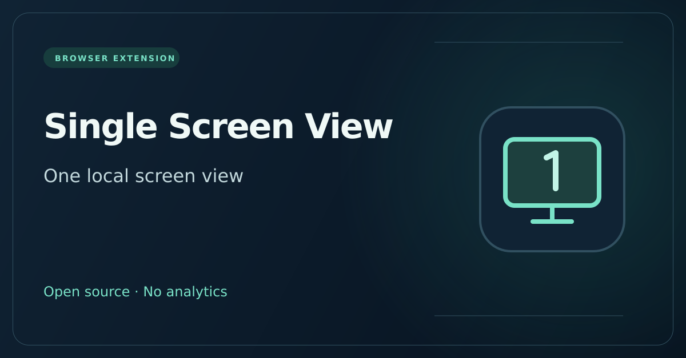

# Single Screen View

A local browser extension that presents one fixed display through supported web screen APIs. The desktop display configuration is unchanged.



**Release status: 0.2.1 public beta.** One user reported the updated extension working in their setup, including after a camera/microphone startup problem. This is user feedback, not an independently verified browser matrix or a confirmed root-cause diagnosis. No extension store approval is claimed.

Download the runtime ZIP from this project's `downloads` directory or the repository's Single Screen View beta release. Store listings will be linked here after approval.

## Features

- One local `ScreenDetails` view and `screen.isExtended === false` where supported.
- Fixed per-document screen values and suppressed physical screen change notifications through the modified APIs.
- Global on/off control, stored locally, and a reload button.
- English and Russian popup, selected by the browser language.
- Optional, user-triggered camera and microphone checks on a separate local extension page; tracks are stopped immediately and nothing is recorded or uploaded.
- No telemetry, remote code, runtime network requests, or external dependencies.

## Install the beta

1. Download and extract `single-screen-view-0.2.1-chromium.zip`. Its root contains `manifest.json`.
2. Open your Chromium browser's extensions page and enable Developer mode.
3. Choose **Load unpacked** and select that extracted directory. If using the source archive instead, select its `extension` directory.
4. Open the popup. Mode is on by default. Reload existing pages to apply it.

After switching off or removing the extension, reload affected pages to restore their native objects. Existing injected code remains until navigation.

Chrome desktop is the primary target (minimum 119). Edge, Opera, Opera GX, Brave and Vivaldi need their own compatibility checks. Firefox, Safari, mobile browsers and the embedded Codex browser are not confirmed targets. See [publishing notes](docs/PUBLISHING.md).

## Limits

This is a JavaScript compatibility facade, not a display driver or a guarantee of concealment. Native apps, capture selection, CSS media queries and window geometry can still expose real information. Synthetic objects differ from native `ScreenDetails` and `ScreenDetailed`, and may cause site compatibility errors. The native `ScreenOrientation` object is retained. Fullscreen requests using this document's synthetic display use the browser's current display, preserving the other options and native restrictions; synthetic display objects from another frame are not translated. Camera and microphone APIs and browser permission controls are not modified.

The optional camera/microphone diagnostic has its own extension-page permission context. Success there establishes only that the browser can open a device for that page; it does not establish the affected website's permissions or iframe policy.

## Verification

Run from this project directory (Node 20+ and Python 3):

```sh
npm test
npm run build
```

No dependency installation is needed. Build outputs appear in `dist`. Icon/promo regeneration is an optional maintainer task using `sharp`; committed PNGs are already included. Repository CI validates this subproject and packages the beta. Model tests do not operate physical devices.

The camera checks run the actual injection in a VM with independent browser fixtures. Seven checks passed: camera API identity, successful streams and constraints, unchanged permission states, and preserved native error objects. These are model checks, not a physical camera test. See [current camera investigation](docs/CAMERA_INVESTIGATION.md).

Fifteen automated checks passed, including camera/microphone API preservation, fullscreen/orientation compatibility and the explicit local diagnostic. The original 0.1 prototype and 0.2.1 update were reported working by one user. Browser integration in the authoring environment was blocked at Chrome process startup by a socket permission restriction. This evidence does not establish compatibility with every browser or website.

## Privacy and license

See [privacy policy](PRIVACY.md). MIT licensed; reuse and contributions are welcome. Report issues in [the repository issue tracker](https://github.com/d1xerzip/AI_JOURNEY/issues) with `[Single Screen View]` in the title, browser/version and reproduction steps. Do not post private interview links, credentials or audio/video.
